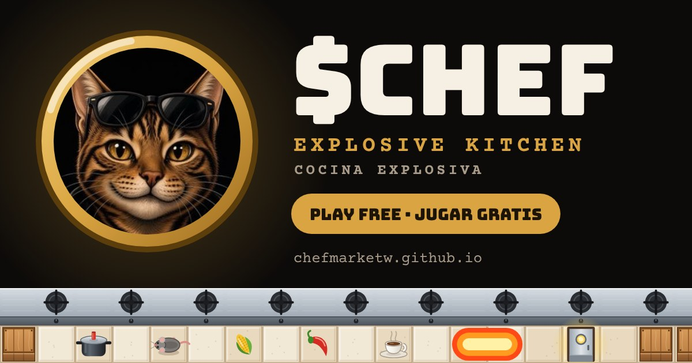

  

<h1 align="center">$CHEF Cocina Explosiva</h1>

<a href="https://chefmarketw.github.io"><b>Play now · Jugar ahora →</b></a>

Free maze game for PC and mobile, no install needed. Drop pressure cookers that blast in a cross, break crates, wipe out the rats and find the hidden door to clear the level.

## How to play

| | PC | Mobile |
|---|---|---|
| Move | Arrows or WASD | On-screen d-pad |
| Drop a pot | Space | POT button |

**Power-ups:** corn (+1 pot at a time), chili (+1 blast range) and coffee (more speed).

**Daily Special:** every day brings 5 levels that are the same for everyone, and you get one try. Share your result on X.

The game comes in English and Spanish and starts in your device's language.

## Español

Juego gratis de laberinto para PC y celular, sin instalar nada. Pon ollas a presión que revientan en cruz, rompe cajas, acaba con las ratas y encuentra la puerta escondida para pasar de nivel.

- **PC:** flechas o WASD para moverte, Espacio para poner una olla.
- **Celular:** cruceta y botón OLLA en pantalla.
- **Ingredientes:** maíz (+1 olla a la vez), ají (+1 de alcance) y café (más velocidad).
- **Menú del día:** cada día hay 5 niveles iguales para todos y un solo intento. Comparte tu resultado en X.

---

**$CHEF** on pump.fun / en pump.fun: <https://pump.fun/coin/2Wib6oHRgzFZaMvZ3uY2zCrVKUK2a26m4j9EZWc2pump>

The game is free and requires no purchase. · El juego es gratis y no requiere comprar nada.

© 2026 Chefmarketw ($CHEF). All rights reserved · Todos los derechos reservados. See / Ver [LICENSE](LICENSE).
